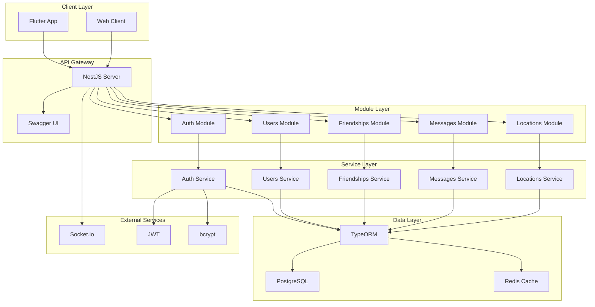

# 백엔드 아키텍처

## 🏗 NestJS 백엔드 구조

### 전체 아키텍처


## 📁 프로젝트 구조

### 디렉토리 구조
```
meal_buddy_server/
├── src/
│   ├── main.ts                    # 애플리케이션 진입점
│   ├── app.module.ts              # 루트 모듈
│   ├── app.controller.ts          # 루트 컨트롤러
│   ├── app.service.ts             # 루트 서비스
│   ├── config/                    # 설정 파일
│   │   ├── database.config.ts     # 데이터베이스 설정
│   │   ├── jwt.config.ts          # JWT 설정
│   │   └── swagger.config.ts      # Swagger 설정
│   ├── modules/                   # 기능별 모듈
│   │   ├── auth/                  # 인증 모듈
│   │   │   ├── auth.module.ts
│   │   │   ├── auth.controller.ts
│   │   │   ├── auth.service.ts
│   │   │   ├── strategies/
│   │   │   │   └── jwt.strategy.ts
│   │   │   └── guards/
│   │   │       └── jwt-auth.guard.ts
│   │   ├── users/                 # 사용자 모듈
│   │   │   ├── users.module.ts
│   │   │   ├── users.controller.ts
│   │   │   ├── users.service.ts
│   │   │   ├── entities/
│   │   │   │   ├── user.entity.ts
│   │   │   │   └── user-settings.entity.ts
│   │   │   └── dto/
│   │   │       ├── create-user.dto.ts
│   │   │       ├── update-user.dto.ts
│   │   │       └── login-user.dto.ts
│   │   ├── friendships/           # 친구 관계 모듈
│   │   │   ├── friendships.module.ts
│   │   │   ├── friendships.controller.ts
│   │   │   ├── friendships.service.ts
│   │   │   ├── entities/
│   │   │   │   ├── friendship.entity.ts
│   │   │   │   └── temperature-history.entity.ts
│   │   │   └── dto/
│   │   │       └── create-friendship.dto.ts
│   │   ├── messages/              # 메시지 모듈
│   │   │   ├── messages.module.ts
│   │   │   ├── messages.controller.ts
│   │   │   ├── messages.service.ts
│   │   │   ├── entities/
│   │   │   │   └── message.entity.ts
│   │   │   └── dto/
│   │   │       └── create-message.dto.ts
│   │   └── locations/             # 위치 모듈
│   │       ├── locations.module.ts
│   │       ├── locations.controller.ts
│   │       ├── locations.service.ts
│   │       └── dto/
│   │           └── update-location.dto.ts
│   ├── common/                    # 공통 모듈
│   │   ├── entities/
│   │   │   └── base.entity.ts
│   │   ├── decorators/
│   │   ├── filters/
│   │   ├── guards/
│   │   ├── interceptors/
│   │   └── pipes/
│   ├── database/                  # 데이터베이스 관련
│   │   ├── migrations/
│   │   └── seeds/
│   └── utils/                     # 유틸리티
├── test/                          # 테스트 파일
├── dist/                          # 빌드 결과물
├── package.json                   # 의존성 및 스크립트
├── tsconfig.json                  # TypeScript 설정
├── nest-cli.json                  # NestJS CLI 설정
├── ormconfig.ts                   # TypeORM 설정
└── README.md                      # 백엔드 문서
```

## 🔧 모듈별 상세 구조

### 1. Auth Module (인증 모듈)
```typescript
@Module({
  imports: [
    UsersModule,
    PassportModule,
    JwtModule.registerAsync({
      useFactory: (configService: ConfigService) => ({
        secret: configService.get<string>('JWT_SECRET'),
        signOptions: { expiresIn: '7d' },
      }),
      inject: [ConfigService],
    }),
  ],
  controllers: [AuthController],
  providers: [AuthService, JwtStrategy],
  exports: [AuthService],
})
export class AuthModule {}
```

**주요 기능:**
- 사용자 회원가입/로그인
- JWT 토큰 생성 및 검증
- 비밀번호 해싱 (bcrypt)
- 인증 가드 및 전략

### 2. Users Module (사용자 모듈)
```typescript
@Module({
  imports: [
    TypeOrmModule.forFeature([User, UserSettings]),
  ],
  controllers: [UsersController],
  providers: [UsersService],
  exports: [UsersService],
})
export class UsersModule {}
```

**주요 기능:**
- 사용자 CRUD 작업
- 프로필 관리
- 위치 기반 사용자 검색
- 온라인 상태 관리

### 3. Friendships Module (친구 관계 모듈)
```typescript
@Module({
  imports: [
    TypeOrmModule.forFeature([Friendship, TemperatureHistory]),
  ],
  controllers: [FriendshipsController],
  providers: [FriendshipsService],
  exports: [FriendshipsService],
})
export class FriendshipsModule {}
```

**주요 기능:**
- 친구 요청/수락/거절
- 친구 목록 관리
- 온도 시스템 관리
- 온도 히스토리 추적

### 4. Messages Module (메시지 모듈)
```typescript
@Module({
  imports: [
    TypeOrmModule.forFeature([Message, Friendship]),
  ],
  controllers: [MessagesController],
  providers: [MessagesService],
  exports: [MessagesService],
})
export class MessagesModule {}
```

**주요 기능:**
- 메시지 전송/조회
- 실시간 채팅 (Socket.io)
- 메시지 읽음 처리
- 온도 변화 트리거

## 🔐 인증 시스템

### JWT 전략
```typescript
@Injectable()
export class JwtStrategy extends PassportStrategy(Strategy) {
  constructor(
    private configService: ConfigService,
    private usersService: UsersService,
  ) {
    super({
      jwtFromRequest: ExtractJwt.fromAuthHeaderAsBearerToken(),
      ignoreExpiration: false,
      secretOrKey: configService.get<string>('JWT_SECRET'),
    });
  }

  async validate(payload: any) {
    return this.usersService.findOne(payload.sub);
  }
}
```

### 인증 가드
```typescript
@Injectable()
export class JwtAuthGuard extends AuthGuard('jwt') {}
```

### 사용 예시
```typescript
@Controller('users')
@UseGuards(JwtAuthGuard)
export class UsersController {
  @Get('profile')
  getProfile(@Request() req) {
    return req.user;
  }
}
```

## 📊 데이터베이스 연결

### TypeORM 설정
```typescript
export const databaseConfig: TypeOrmModuleOptions = {
  type: 'postgres',
  host: process.env.DB_HOST || 'localhost',
  port: parseInt(process.env.DB_PORT || '5432'),
  username: process.env.DB_USERNAME || 'postgres',
  password: process.env.DB_PASSWORD || 'password',
  database: process.env.DB_NAME || 'bapbuddy_db',
  entities: [__dirname + '/../**/*.entity{.ts,.js}'],
  migrations: [__dirname + '/../database/migrations/*{.ts,.js}'],
  synchronize: process.env.NODE_ENV !== 'production',
  logging: process.env.NODE_ENV === 'development',
  ssl: process.env.NODE_ENV === 'production' ? { rejectUnauthorized: false } : false,
  extra: {
    connectionLimit: 10,
  },
};
```

## 🔌 Socket.io 설정

### WebSocket 게이트웨이
```typescript
@WebSocketGateway({
  cors: {
    origin: "*",
  },
})
export class ChatGateway implements OnGatewayConnection, OnGatewayDisconnect {
  @WebSocketServer()
  server: Server;

  handleConnection(client: Socket) {
    console.log(`Client connected: ${client.id}`);
  }

  handleDisconnect(client: Socket) {
    console.log(`Client disconnected: ${client.id}`);
  }

  @SubscribeMessage('join_room')
  handleJoinRoom(client: Socket, payload: { friendship_id: number }) {
    client.join(`room_${payload.friendship_id}`);
    return { event: 'joined_room', room: `room_${payload.friendship_id}` };
  }

  @SubscribeMessage('send_message')
  async handleMessage(client: Socket, payload: any) {
    // 메시지 저장 및 전송
    const message = await this.messagesService.create(payload);
    this.server.to(`room_${payload.friendship_id}`).emit('receive_message', message);
  }
}
```

## 📝 DTO (Data Transfer Object)

### 사용자 생성 DTO
```typescript
export class CreateUserDto {
  @IsEmail()
  email: string;

  @IsString()
  @MinLength(6)
  password: string;

  @IsString()
  @MinLength(2)
  @MaxLength(20)
  nickname: string;

  @IsArray()
  @IsString({ each: true })
  food_preferences: string[];

  @IsOptional()
  @IsUrl()
  profile_image_url?: string;
}
```

### 메시지 생성 DTO
```typescript
export class CreateMessageDto {
  @IsNumber()
  friendship_id: number;

  @IsString()
  @MinLength(1)
  content: string;

  @IsEnum(MessageType)
  message_type: MessageType;

  @IsOptional()
  @IsUrl()
  image_url?: string;
}
```

## 🔍 서비스 로직

### 사용자 서비스 예시
```typescript
@Injectable()
export class UsersService {
  constructor(
    @InjectRepository(User)
    private usersRepository: Repository<User>,
    @InjectRepository(UserSettings)
    private userSettingsRepository: Repository<UserSettings>,
  ) {}

  async create(createUserDto: CreateUserDto): Promise<User> {
    const hashedPassword = await bcrypt.hash(createUserDto.password, 10);
    
    const user = this.usersRepository.create({
      ...createUserDto,
      password_hash: hashedPassword,
    });
    
    const savedUser = await this.usersRepository.save(user);
    
    // 사용자 설정 생성
    await this.userSettingsRepository.save({
      user: savedUser,
    });
    
    return savedUser;
  }

  async findNearbyUsers(latitude: number, longitude: number, maxDistance: number = 1000): Promise<any[]> {
    const users = await this.usersRepository
      .createQueryBuilder('user')
      .select([
        'user.id',
        'user.nickname',
        'user.food_preferences',
        'user.profile_image_url',
        'user.latitude',
        'user.longitude',
      ])
      .where('user.latitude IS NOT NULL')
      .andWhere('user.longitude IS NOT NULL')
      .getMany();

    return users
      .map(user => {
        const distance = this.calculateDistance(latitude, longitude, user.latitude, user.longitude);
        return { user, distance };
      })
      .filter(item => item.distance <= maxDistance)
      .sort((a, b) => a.distance - b.distance);
  }

  private calculateDistance(lat1: number, lon1: number, lat2: number, lon2: number): number {
    const R = 6371e3; // 지구 반지름 (미터)
    const φ1 = lat1 * Math.PI / 180;
    const φ2 = lat2 * Math.PI / 180;
    const Δφ = (lat2 - lat1) * Math.PI / 180;
    const Δλ = (lon2 - lon1) * Math.PI / 180;

    const a = Math.sin(Δφ / 2) * Math.sin(Δφ / 2) +
              Math.cos(φ1) * Math.cos(φ2) *
              Math.sin(Δλ / 2) * Math.sin(Δλ / 2);
    const c = 2 * Math.atan2(Math.sqrt(a), Math.sqrt(1 - a));

    return R * c;
  }
}
```

## 🧪 테스트 구조

### 단위 테스트
```typescript
describe('UsersService', () => {
  let service: UsersService;
  let repository: Repository<User>;

  beforeEach(async () => {
    const module: TestingModule = await Test.createTestingModule({
      providers: [
        UsersService,
        {
          provide: getRepositoryToken(User),
          useClass: Repository,
        },
      ],
    }).compile();

    service = module.get<UsersService>(UsersService);
    repository = module.get<Repository<User>>(getRepositoryToken(User));
  });

  it('should be defined', () => {
    expect(service).toBeDefined();
  });

  describe('create', () => {
    it('should create a new user', async () => {
      const createUserDto = {
        email: 'test@example.com',
        password: 'password123',
        nickname: 'TestUser',
        food_preferences: ['한식'],
      };

      const expectedUser = { id: 1, ...createUserDto };
      jest.spyOn(repository, 'create').mockReturnValue(expectedUser as User);
      jest.spyOn(repository, 'save').mockResolvedValue(expectedUser as User);

      const result = await service.create(createUserDto);
      expect(result).toEqual(expectedUser);
    });
  });
});
```

## 🚀 배포 설정

### Docker 설정
```dockerfile
FROM node:18-alpine

WORKDIR /app

COPY package*.json ./
RUN npm ci --only=production

COPY . .
RUN npm run build

EXPOSE 3000

CMD ["npm", "run", "start:prod"]
```

### Docker Compose
```yaml
version: '3.8'
services:
  app:
    build: .
    ports:
      - "3000:3000"
    environment:
      - NODE_ENV=production
      - DB_HOST=postgres
      - DB_PORT=5432
      - DB_USERNAME=postgres
      - DB_PASSWORD=password
      - DB_NAME=bapbuddy_db
    depends_on:
      - postgres
      - redis

  postgres:
    image: postgres:14
    environment:
      - POSTGRES_DB=bapbuddy_db
      - POSTGRES_USER=postgres
      - POSTGRES_PASSWORD=password
    volumes:
      - postgres_data:/var/lib/postgresql/data
    ports:
      - "5432:5432"

  redis:
    image: redis:7-alpine
    ports:
      - "6379:6379"

volumes:
  postgres_data:
```

---

**버전**: 1.0.0  
**최종 업데이트**: 2024-08-30  
**작성자**: 개발팀
