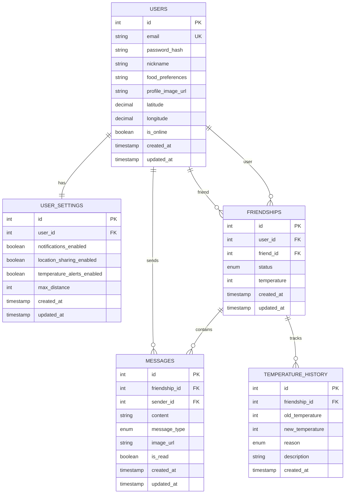

# 데이터 모델

## 📊 데이터베이스 스키마

### 전체 ERD (Entity Relationship Diagram)


## 🗃️ 엔티티 상세

### 1. User (사용자)
```typescript
@Entity('users')
export class User extends BaseEntity {
  @PrimaryGeneratedColumn()
  id: number;

  @Column({ unique: true })
  email: string;

  @Column()
  password_hash: string;

  @Column()
  nickname: string;

  @Column('simple-array')
  food_preferences: string[];

  @Column({ nullable: true })
  profile_image_url: string;

  @Column('decimal', { precision: 10, scale: 8, nullable: true })
  latitude: number;

  @Column('decimal', { precision: 11, scale: 8, nullable: true })
  longitude: number;

  @Column({ default: false })
  is_online: boolean;

  @OneToOne(() => UserSettings, settings => settings.user)
  settings: UserSettings;

  @OneToMany(() => Friendship, friendship => friendship.user)
  friendships: Friendship[];

  @OneToMany(() => Friendship, friendship => friendship.friend)
  friendOf: Friendship[];

  @OneToMany(() => Message, message => message.sender)
  messages: Message[];
}
```

### 2. UserSettings (사용자 설정)
```typescript
@Entity('user_settings')
export class UserSettings extends BaseEntity {
  @PrimaryGeneratedColumn()
  id: number;

  @OneToOne(() => User, user => user.settings)
  @JoinColumn()
  user: User;

  @Column({ default: true })
  notifications_enabled: boolean;

  @Column({ default: true })
  location_sharing_enabled: boolean;

  @Column({ default: true })
  temperature_alerts_enabled: boolean;

  @Column({ default: 1000 })
  max_distance: number;
}
```

### 3. Friendship (친구 관계)
```typescript
@Entity('friendships')
export class Friendship extends BaseEntity {
  @PrimaryGeneratedColumn()
  id: number;

  @ManyToOne(() => User, user => user.friendships)
  @JoinColumn()
  user: User;

  @ManyToOne(() => User, user => user.friendOf)
  @JoinColumn()
  friend: User;

  @Column({
    type: 'enum',
    enum: FriendshipStatus,
    default: FriendshipStatus.PENDING
  })
  status: FriendshipStatus;

  @Column({ default: 50 })
  temperature: number;

  @OneToMany(() => Message, message => message.friendship)
  messages: Message[];

  @OneToMany(() => TemperatureHistory, history => history.friendship)
  temperature_history: TemperatureHistory[];
}
```

### 4. Message (메시지)
```typescript
@Entity('messages')
export class Message extends BaseEntity {
  @PrimaryGeneratedColumn()
  id: number;

  @ManyToOne(() => Friendship, friendship => friendship.messages)
  @JoinColumn()
  friendship: Friendship;

  @ManyToOne(() => User, user => user.messages)
  @JoinColumn()
  sender: User;

  @Column()
  content: string;

  @Column({
    type: 'enum',
    enum: MessageType,
    default: MessageType.TEXT
  })
  message_type: MessageType;

  @Column({ nullable: true })
  image_url: string;

  @Column({ default: false })
  is_read: boolean;
}
```

### 5. TemperatureHistory (온도 히스토리)
```typescript
@Entity('temperature_history')
export class TemperatureHistory extends BaseEntity {
  @PrimaryGeneratedColumn()
  id: number;

  @ManyToOne(() => Friendship, friendship => friendship.temperature_history)
  @JoinColumn()
  friendship: Friendship;

  @Column()
  old_temperature: number;

  @Column()
  new_temperature: number;

  @Column({
    type: 'enum',
    enum: TemperatureReason
  })
  reason: TemperatureReason;

  @Column({ nullable: true })
  description: string;
}
```

## 📋 열거형 (Enum)

### FriendshipStatus (친구 관계 상태)
```typescript
export enum FriendshipStatus {
  PENDING = 'pending',    // 대기 중
  ACCEPTED = 'accepted',  // 수락됨
  REJECTED = 'rejected',  // 거절됨
  BLOCKED = 'blocked'     // 차단됨
}
```

### MessageType (메시지 타입)
```typescript
export enum MessageType {
  TEXT = 'text',           // 텍스트
  IMAGE = 'image',         // 이미지
  LOCATION = 'location',   // 위치
  SYSTEM = 'system'        // 시스템 메시지
}
```

### TemperatureReason (온도 변화 이유)
```typescript
export enum TemperatureReason {
  MESSAGE_SENT = 'message_sent',           // 메시지 전송
  MESSAGE_READ = 'message_read',           // 메시지 읽음
  LOCATION_SHARED = 'location_shared',     // 위치 공유
  MEAL_TOGETHER = 'meal_together',         // 함께 식사
  APPOINTMENT_CANCELLED = 'appointment_cancelled', // 약속 취소
  SYSTEM_ADJUSTMENT = 'system_adjustment'  // 시스템 조정
}
```

## 🔍 인덱스 설계

### 성능 최적화를 위한 인덱스
```sql
-- 사용자 이메일 검색
CREATE INDEX idx_users_email ON users(email);

-- 위치 기반 검색
CREATE INDEX idx_users_location ON users(latitude, longitude);

-- 온라인 상태 검색
CREATE INDEX idx_users_online ON users(is_online);

-- 친구 관계 검색
CREATE INDEX idx_friendships_users ON friendships(user_id, friend_id);
CREATE INDEX idx_friendships_status ON friendships(status);

-- 메시지 검색
CREATE INDEX idx_messages_friendship ON messages(friendship_id);
CREATE INDEX idx_messages_sender ON messages(sender_id);
CREATE INDEX idx_messages_created ON messages(created_at);

-- 온도 히스토리 검색
CREATE INDEX idx_temperature_history_friendship ON temperature_history(friendship_id);
CREATE INDEX idx_temperature_history_created ON temperature_history(created_at);
```

## 📊 데이터 타입 매핑

### PostgreSQL ↔ TypeScript 타입 매핑
| PostgreSQL | TypeScript | 설명 |
|------------|------------|------|
| `integer` | `number` | 정수 |
| `decimal` | `number` | 소수점 |
| `varchar` | `string` | 문자열 |
| `text` | `string` | 긴 문자열 |
| `boolean` | `boolean` | 불린 |
| `timestamp` | `Date` | 날짜/시간 |
| `enum` | `enum` | 열거형 |
| `json` | `object` | JSON 객체 |
| `simple-array` | `string[]` | 문자열 배열 |

## 🔄 데이터 관계

### 1:1 관계
- **User ↔ UserSettings**: 사용자당 하나의 설정

### 1:N 관계
- **User → Friendship**: 사용자가 여러 친구 관계 가질 수 있음
- **User → Message**: 사용자가 여러 메시지 보낼 수 있음
- **Friendship → Message**: 친구 관계에 여러 메시지 포함
- **Friendship → TemperatureHistory**: 친구 관계의 온도 변화 기록

### N:M 관계
- **User ↔ User**: 친구 관계를 통한 다대다 관계

## 📈 데이터 샘플

### 사용자 데이터 예시
```json
{
  "id": 1,
  "email": "user@example.com",
  "nickname": "김밥친구",
  "food_preferences": ["한식", "중식"],
  "profile_image_url": "https://example.com/profile.jpg",
  "latitude": 37.5665,
  "longitude": 126.9780,
  "is_online": true,
  "created_at": "2024-08-30T10:00:00Z"
}
```

### 친구 관계 데이터 예시
```json
{
  "id": 1,
  "user_id": 1,
  "friend_id": 2,
  "status": "accepted",
  "temperature": 75,
  "created_at": "2024-08-30T10:00:00Z"
}
```

### 메시지 데이터 예시
```json
{
  "id": 1,
  "friendship_id": 1,
  "sender_id": 1,
  "content": "안녕하세요! 밥 같이 먹을까요?",
  "message_type": "text",
  "is_read": false,
  "created_at": "2024-08-30T14:30:00Z"
}
```

### 온도 히스토리 데이터 예시
```json
{
  "id": 1,
  "friendship_id": 1,
  "old_temperature": 70,
  "new_temperature": 75,
  "reason": "message_sent",
  "description": "메시지 전송으로 온도 증가",
  "created_at": "2024-08-30T14:30:00Z"
}
```

## 🔒 데이터 무결성

### 외래 키 제약 조건
```sql
-- UserSettings → User
ALTER TABLE user_settings 
ADD CONSTRAINT fk_user_settings_user 
FOREIGN KEY (user_id) REFERENCES users(id) ON DELETE CASCADE;

-- Friendship → User (user)
ALTER TABLE friendships 
ADD CONSTRAINT fk_friendships_user 
FOREIGN KEY (user_id) REFERENCES users(id) ON DELETE CASCADE;

-- Friendship → User (friend)
ALTER TABLE friendships 
ADD CONSTRAINT fk_friendships_friend 
FOREIGN KEY (friend_id) REFERENCES users(id) ON DELETE CASCADE;

-- Message → Friendship
ALTER TABLE messages 
ADD CONSTRAINT fk_messages_friendship 
FOREIGN KEY (friendship_id) REFERENCES friendships(id) ON DELETE CASCADE;

-- Message → User
ALTER TABLE messages 
ADD CONSTRAINT fk_messages_sender 
FOREIGN KEY (sender_id) REFERENCES users(id) ON DELETE CASCADE;

-- TemperatureHistory → Friendship
ALTER TABLE temperature_history 
ADD CONSTRAINT fk_temperature_history_friendship 
FOREIGN KEY (friendship_id) REFERENCES friendships(id) ON DELETE CASCADE;
```

### 체크 제약 조건
```sql
-- 온도 범위 체크
ALTER TABLE friendships 
ADD CONSTRAINT chk_temperature_range 
CHECK (temperature >= 0 AND temperature <= 100);

-- 위도 범위 체크
ALTER TABLE users 
ADD CONSTRAINT chk_latitude_range 
CHECK (latitude >= -90 AND latitude <= 90);

-- 경도 범위 체크
ALTER TABLE users 
ADD CONSTRAINT chk_longitude_range 
CHECK (longitude >= -180 AND longitude <= 180);
```

---

**버전**: 1.0.0  
**최종 업데이트**: 2024-08-30  
**작성자**: 개발팀
