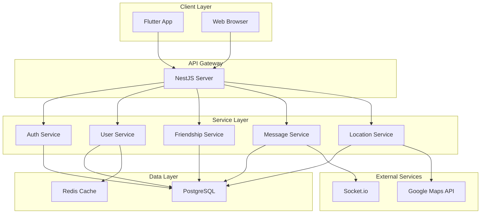
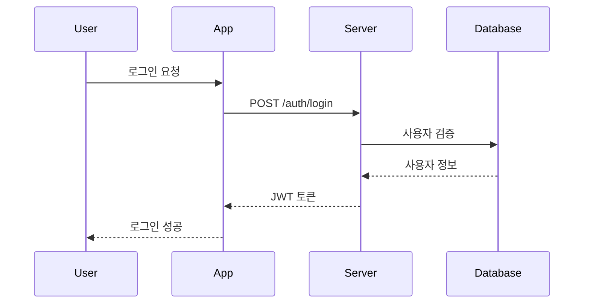
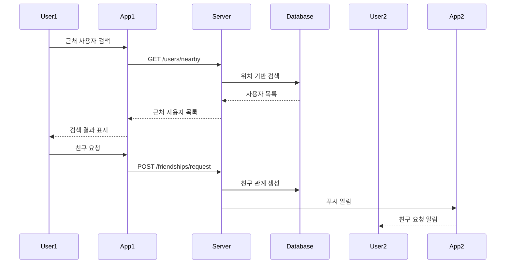
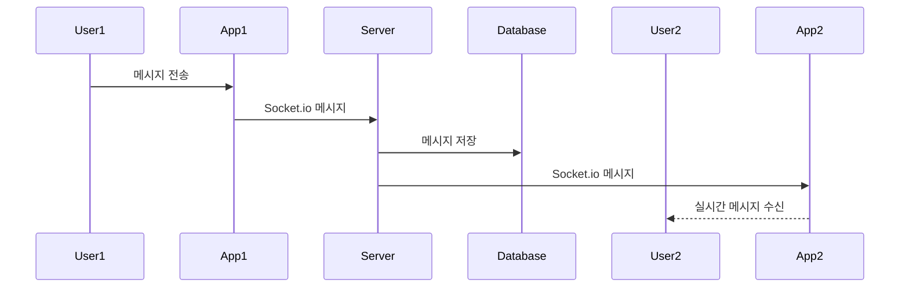

# 시스템 아키텍처

## 🏗 전체 시스템 구조



## 🛠 기술 스택 상세

### Frontend (Flutter)
| 기술 | 버전 | 용도 |
|------|------|------|
| Flutter | 3.x | 크로스 플랫폼 UI 프레임워크 |
| Dart | 3.x | 프로그래밍 언어 |
| GetX | 4.x | 상태 관리 및 라우팅 |
| Dio | 5.x | HTTP 클라이언트 |
| Socket.io Client | 2.x | 실시간 통신 |
| Google Maps Flutter | 2.x | 지도 서비스 |
| Image Picker | 1.x | 이미지 선택 |
| Cached Network Image | 3.x | 이미지 캐싱 |

### Backend (NestJS)
| 기술 | 버전 | 용도 |
|------|------|------|
| NestJS | 10.x | Node.js 프레임워크 |
| TypeScript | 5.x | 프로그래밍 언어 |
| TypeORM | 0.3.x | ORM |
| PostgreSQL | 14+ | 관계형 데이터베이스 |
| JWT | 9.x | 인증 토큰 |
| Passport | 0.7.x | 인증 전략 |
| Socket.io | 4.x | 실시간 통신 |
| Swagger | 7.x | API 문서화 |
| class-validator | 0.14.x | 입력 검증 |
| bcrypt | 5.x | 비밀번호 해싱 |

## 📁 프로젝트 구조

### Backend 구조
```
meal_buddy_server/
├── src/
│   ├── main.ts                    # 애플리케이션 진입점
│   ├── app.module.ts              # 루트 모듈
│   ├── app.controller.ts          # 루트 컨트롤러
│   ├── app.service.ts             # 루트 서비스
│   ├── config/                    # 설정 파일
│   │   ├── database.config.ts     # 데이터베이스 설정
│   │   ├── jwt.config.ts          # JWT 설정
│   │   └── swagger.config.ts      # Swagger 설정
│   ├── modules/                   # 기능별 모듈
│   │   ├── auth/                  # 인증 모듈
│   │   ├── users/                 # 사용자 모듈
│   │   ├── friendships/           # 친구 관계 모듈
│   │   ├── messages/              # 메시지 모듈
│   │   └── locations/             # 위치 모듈
│   ├── common/                    # 공통 모듈
│   │   ├── entities/              # 기본 엔티티
│   │   ├── decorators/            # 커스텀 데코레이터
│   │   ├── filters/               # 예외 필터
│   │   ├── guards/                # 가드
│   │   ├── interceptors/          # 인터셉터
│   │   └── pipes/                 # 파이프
│   ├── database/                  # 데이터베이스 관련
│   │   ├── migrations/            # 마이그레이션
│   │   └── seeds/                 # 시드 데이터
│   └── utils/                     # 유틸리티
├── test/                          # 테스트 파일
├── dist/                          # 빌드 결과물
├── package.json                   # 의존성 및 스크립트
├── tsconfig.json                  # TypeScript 설정
├── nest-cli.json                  # NestJS CLI 설정
├── ormconfig.ts                   # TypeORM 설정
└── README.md                      # 백엔드 문서
```

### Frontend 구조
```
meal_buddy_app/
├── lib/
│   ├── main.dart                # 앱 진입점
│   ├── app/
│   │   ├── app.dart             # 앱 설정
│   │   ├── theme.dart           # 테마 설정
│   │   └── routes.dart          # 라우트 설정
│   ├── core/
│   │   ├── constants/           # 상수 정의
│   │   ├── services/            # 서비스 클래스
│   │   ├── models/              # 데이터 모델
│   │   └── utils/               # 유틸리티
│   ├── presentation/
│   │   ├── screens/             # 화면 위젯
│   │   ├── widgets/             # 재사용 위젯
│   │   └── controllers/         # GetX 컨트롤러
│   └── data/
│       ├── repositories/        # 데이터 저장소
│       └── datasources/         # 데이터 소스
├── assets/                      # 리소스 파일
└── pubspec.yaml                 # Flutter 의존성
```

## 🔄 데이터 흐름

### 1. 사용자 인증 흐름


### 2. 친구 매칭 흐름


### 3. 실시간 채팅 흐름


## 🔒 보안 아키텍처

### 인증 및 권한
- **JWT 토큰**: 액세스 토큰 (7일) + 리프레시 토큰 (30일)
- **비밀번호 해싱**: bcrypt (salt rounds: 10)
- **API 보호**: JWT 가드를 통한 엔드포인트 보호
- **CORS**: 허용된 도메인만 접근 가능

### 데이터 보안
- **HTTPS**: 모든 통신 암호화
- **입력 검증**: class-validator를 통한 서버사이드 검증
- **SQL Injection 방지**: TypeORM 파라미터화된 쿼리
- **XSS 방지**: 입력 데이터 이스케이프

## 📊 성능 최적화

### 데이터베이스 최적화
- **인덱스**: 위치, 사용자 ID, 친구 관계 인덱스
- **쿼리 최적화**: N+1 문제 해결을 위한 relations 사용
- **연결 풀**: TypeORM 연결 풀 설정
- **캐싱**: Redis를 통한 자주 조회되는 데이터 캐싱

### API 최적화
- **페이지네이션**: 대용량 데이터 처리
- **압축**: gzip 압축 활성화
- **CDN**: 정적 파일 CDN 사용
- **로드 밸런싱**: 다중 서버 구성

## 🚀 배포 아키텍처

### 개발 환경
```
┌─────────────────┐    ┌─────────────────┐    ┌─────────────────┐
│   Flutter App   │    │   NestJS Dev    │    │   PostgreSQL    │
│   (Local)       │◄──►│   (Local:3000)  │◄──►│   (Local:5432)  │
└─────────────────┘    └─────────────────┘    └─────────────────┘
```

### 프로덕션 환경
```
┌─────────────────┐    ┌─────────────────┐    ┌─────────────────┐
│   CDN/Cloud     │    │   Load Balancer │    │   App Servers   │
│   Storage       │    │                 │    │   (NestJS)      │
└─────────────────┘    └─────────────────┘    └─────────────────┘
                              │                        │
                              ▼                        ▼
                       ┌─────────────────┐    ┌─────────────────┐
                       │   Redis Cache   │    │   PostgreSQL    │
                       │   (Cluster)     │    │   (Master/Slave)│
                       └─────────────────┘    └─────────────────┘
```

## 🔧 모니터링 및 로깅

### 모니터링
- **애플리케이션 모니터링**: NestJS 내장 로거
- **데이터베이스 모니터링**: PostgreSQL 통계
- **서버 모니터링**: CPU, 메모리, 디스크 사용량
- **API 모니터링**: 응답 시간, 에러율

### 로깅
- **구조화된 로깅**: JSON 형식 로그
- **로그 레벨**: ERROR, WARN, INFO, DEBUG
- **로그 저장**: 파일 및 클라우드 로그 서비스
- **로그 분석**: ELK 스택 또는 유사 도구

---

**버전**: 1.0.0  
**최종 업데이트**: 2024-08-30  
**작성자**: 개발팀
